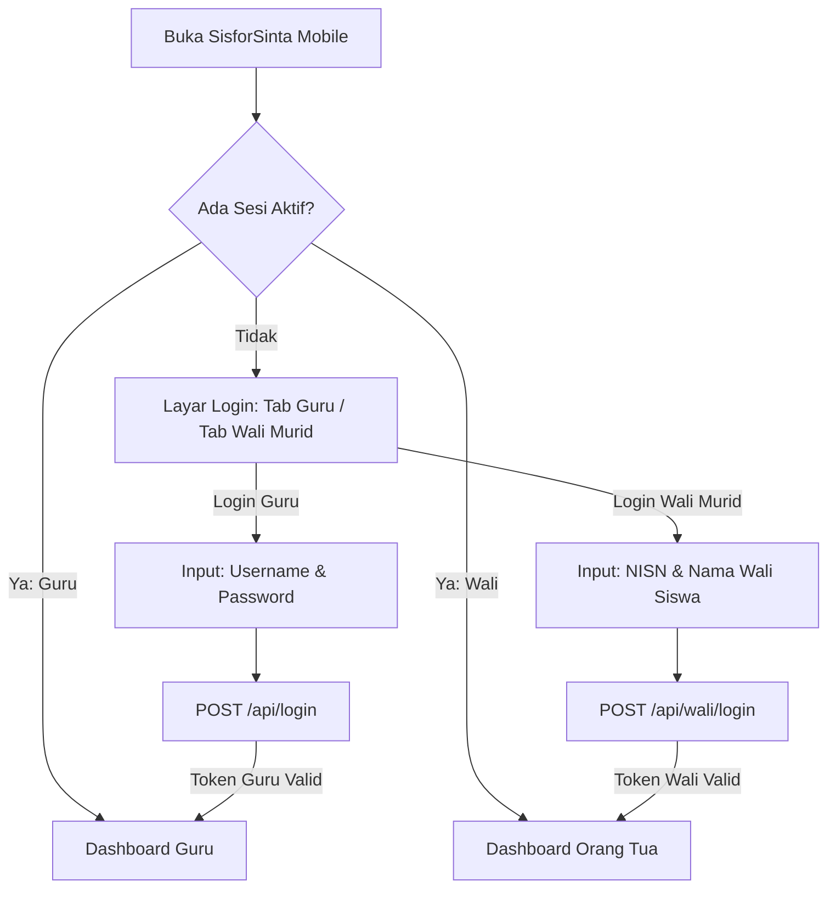
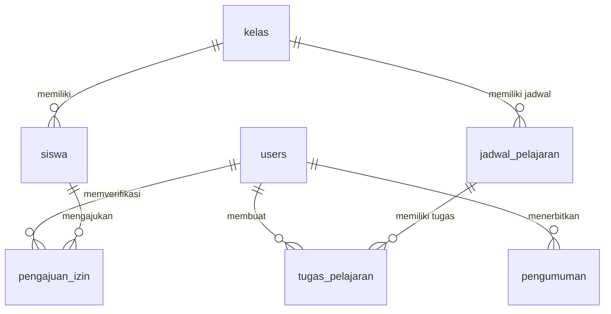
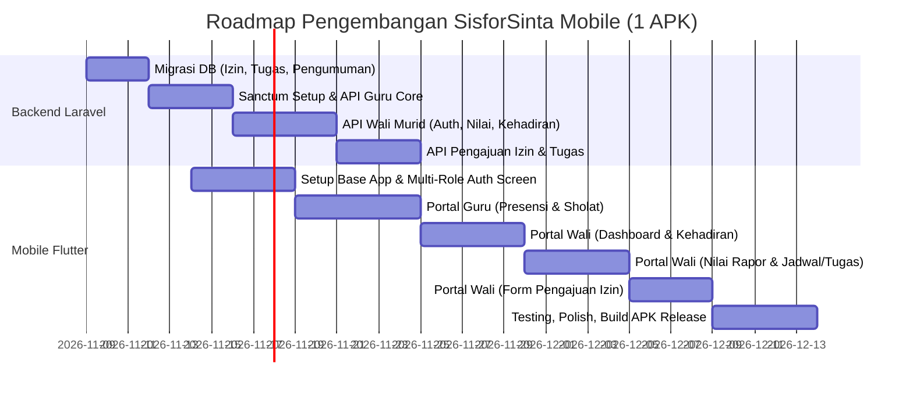

# PRD: SisforSinta Mobile (1 APK Terpadu: Guru & Wali Murid)

**Produk:** SisforSinta Mobile — Aplikasi Mobile SDIT Darul Fikri (Guru & Portal Orang Tua)  
**Versi:** 2.0 (Dual Role dalam 1 APK)  
**Tanggal:** 7 November 2026  
**Status:** Ready for Review / Execution  

---

## Daftar Isi

1. [Ringkasan Eksekutif](#1-ringkasan-eksekutif)
2. [Arsitektur Aplikasi (1 APK Dual-Role)](#2-arsitektur-aplikasi-1-apk-dual-role)
3. [Persona & Hak Akses Pengguna](#3-persona--hak-akses-pengguna)
4. [Scope Fitur Terintegrasi](#4-scope-fitur-terintegrasi)
5. [Kebutuhan Fungsional: Portal Orang Tua (Wali Murid)](#5-kebutuhan-fungsional-portal-orang-tua-wali-murid)
6. [Kebutuhan Fungsional: Portal Guru & Tenaga Pendidik](#6-kebutuhan-fungsional-portal-guru--tenaga-pendidik)
7. [Penambahan Skema Database Backend](#7-penambahan-skema-database-backend)
8. [Kontrak API Lengkap](#8-kontrak-api-lengkap)
9. [User Flow & Arsitektur Navigasi](#9-user-flow--arsitektur-navigasi)
10. [Kebutuhan Non-Fungsional & Keamanan](#10-kebutuhan-non-fungsional--keamanan)
11. [Roadmap & Rencana Pengerjaan](#11-roadmap--rencana-pengerjaan)

---

## 1. Ringkasan Eksekutif

SisforSinta Mobile adalah satu aplikasi (*single mobile application*) berbasis Flutter yang melayani dua kelompok pengguna utama sekolah SDIT Darul Fikri:
1. **Guru / Tenaga Pendidik**: Input presensi kelas, presensi sholat (Dhuha & Zuhur), input catatan tugas pelajaran, dan verifikasi izin siswa.
2. **Orang Tua / Wali Murid**: Memantau perkembangan harian anak secara transparan (kehadiran & sholat harian, tugas di jadwal sekolah, hasil studi nilai rapor, pengumuman sekolah, serta pengajuan izin/sakit mandiri).

Aplikasi ini terhubung langsung ke backend Laravel 12 yang sudah ada melalui REST API berbasis Laravel Sanctum.

---

## 2. Arsitektur Aplikasi (1 APK Dual-Role)

Satu aplikasi APK yang sama diunduh oleh guru dan orang tua. Di layar awal terdapat pemilih peran login:



---

## 3. Persona & Hak Akses Pengguna

| Role | Metode Login | Hak Akses Utama |
|---|---|---|
| **Guru Pengajar** | `username` + `password` (tabel `users`) | Presensi kelas per jadwal, kelola tugas mapel, dashboard kehadiran harian, edit profil |
| **Wali Kelas** | `username` + `password` (tabel `users`) | Semua hak guru + Presensi Sholat (Dhuha & Zuhur), verifikasi persetujuan izin sakit/izin siswa kelasnya, rekap nilai |
| **Wali Murid / Orang Tua** | `nisn` + `nama_wali` (tabel `siswa`) | Melihat data anak: kehadiran, sholat, jadwal & tugas sekolah, rapor, kirim pengajuan izin, baca pengumuman |
| **Kepala Sekolah (Admin)** | `admin` + `password` | Monitoring dashboard statistik keseluruhan sekolah |

---

## 4. Scope Fitur Terintegrasi

### Modul Orang Tua (Wali Murid)
1. **Login Sederhana Tanpa Registrasi Manual**: Menggunakan kombinasi **NISN** anak dan **Nama Wali Siswa** yang tercatat di sistem data siswa (pencocokan nama fleksibel/case-insensitive).
2. **Dashboard Anak**:
   - Status presensi masuk sekolah hari ini.
   - Status ibadah sholat hari ini (Dhuha & Zuhur).
   - Pengingat tugas/PR aktif yang harus dikerjakan anak.
   - Jadwal mata pelajaran hari ini & besok.
3. **Cek Kehadiran & Sholat**:
   - Riwayat presensi kelas per mapel (Hadir, Sakit, Izin, Alpa) dengan persentase kehadiran bulanan.
   - Riwayat sholat berjamaah di sekolah (Dhuha & Zuhur).
4. **Hasil Studi (Nilai Rapor & Evaluasi Formatif)**:
   - Nilai rapor semester per mata pelajaran.
   - Rincian nilai formatif BAB 1-4 (Tugas Penilaian 1-4 & Ulangan Harian).
   - Nilai Sumatif Akhir Semester (SAS).
   - Status kompetensi (**Tuntas** vs **Perlu Remedial**).
5. **Jadwal Pelajaran & Pengingat Tugas**:
   - Jadwal harian (hari, jam mulai-selesai, mata pelajaran, nama guru pengajar).
   - Catatan tugas dari guru (judul tugas, deskripsi, batas waktu/deadline pengumpulan).
6. **Pengajuan Izin / Sakit Online**:
   - Form kirim surat izin: tanggal mulai & selesai, jenis (Sakit / Izin), alasan, serta unggah foto surat dokter / surat wali.
   - Riwayat status izin (Menunggu Konfirmasi, Disetujui, Ditolak).
7. **Pengumuman Sekolah**:
   - Informasi resmi sekolah (kegiatan manasik haji, ujian, libur sekolah, agenda parenting).

### Modul Guru & Tenaga Pendidik
1. **Presensi Kelas Real-Time**: Batch input kehadiran siswa per jadwal mapel yang diajar.
2. **Presensi Sholat (Wali Kelas)**: Batch input sholat Dhuha (kelas 1-6) dan Zuhur (kelas 3-6).
3. **Pemberian Catatan Tugas**: Guru mapel bisa membuat catatan tugas/PR untuk jadwal pelajarannya, otomatis terkirim sebagai pengingat di HP orang tua.
4. **Verifikasi Pengajuan Izin**: Wali kelas dapat menyetujui pengajuan izin orang tua, langsung memperbarui status presensi siswa secara otomatis.
5. **Dashboard & Rekap**: Ringkasan kehadiran dan rekapitulasi data.

---

## 5. Kebutuhan Fungsional: Portal Orang Tua (Wali Murid)

### F-W01: Autentikasi Wali Murid
* **Masukan:** NISN Siswa (wajib, 10 digit) & Nama Lengkap Wali Murid (wajib, sesuai nama yang terdaftar di data siswa).
* **Validasi Server:** Mencari record di tabel `siswa` di mana `nisn = input.nisn` dan `LOWER(TRIM(nama_wali)) = LOWER(TRIM(input.nama_wali))`. Siswa harus berstatus `Aktif`.
* **Keluaran:** Personal Access Token Sanctum dengan token name `wali-mobile`, objek data profil siswa, dan data kelasnya.

### F-W02: Dashboard Ringkasan Anak
* Menampilkan kartu status hari ini:
  * Kehadiran masuk kelas: `Belum Diabsen` / `Hadir` / `Sakit` / `Izin` / `Alpa`.
  * Sholat Dhuha: `Sudah` / `Belum` / `Berhalangan`.
  * Sholat Zuhur: `Sudah` / `Belum` / `Berhalangan` (untuk kelas 3-6).
* Pengingat Tugas Sekolah: Daftar tugas dengan deadline terdekat (H-1 atau hari ini).
* Banner pengumuman sekolah terbaru.

### F-W03: Monitoring Kehadiran & Sholat
* Tab 1: **Kehadiran Kelas** — Kalender/riwayat absensi bulanan. Setiap tanggal menampilkan status H/I/S/A beserta nama mata pelajarannya.
* Tab 2: **Ibadah Sholat** — Riwayat sholat Dhuha dan Zuhur harian bersumber dari catatan wali kelas.

### F-W04: Hasil Studi & Transparansi Nilai
* Memilih Tahun Ajaran / Semester (default semester aktif).
* Daftar mata pelajaran beserta nilai akhir rapor dan predikat (A/B/C/D).
* Tap mata pelajaran untuk melihat rincian transparan:
  * Formatif BAB 1 s/d BAB 4 (TP 1, TP 2, TP 3, TP 4, Ulangan Harian).
  * Nilai SAS (Sumatif Akhir Semester).
  * Catatan ketercapaian dan status apakah anak perlu remedial (< 75).

### F-W05: Jadwal & Pengingat Tugas
* Menampilkan daftar hari (Senin s/d Sabtu).
* Item jadwal: Jam pelajaran, nama mapel, guru pengampu.
* Jika ada tugas dari guru pada mapel tersebut, tampil badge **"Ada Tugas"** yang dapat dibuka untuk melihat detail instruksi & deadline.

### F-W06: Pengajuan Izin / Sakit Mandiri
* Form input:
  * Jenis: Sakit / Izin.
  * Tanggal mulai s/d tanggal selesai.
  * Alasan izin (teks keterangan).
  * Lampiran foto surat keterangan / bukti dokter (kamera atau galeri).
* Halaman riwayat menampilkan status:
  * 🟡 **Menunggu Konfirmasi**: Belum ditinjau wali kelas.
  * 🟢 **Disetujui**: Sudah disetujui wali kelas, presensi otomatis tercatat Sakit/Izin.
  * 🔴 **Ditolak**: Ditolak wali kelas disertai catatan alasan penolakan.

### F-W07: Pengumuman Sekolah
* Menampilkan daftar pengumuman yang ditujukan untuk orang tua / umum.
* Detail pengumuman: Tanggal publikasi, judul, isi lengkap, dan lampiran gambar/file PDF.

---

## 6. Kebutuhan Fungsional: Portal Guru & Tenaga Pendidik

### F-G01: Autentikasi Guru & Admin
* Login via `username` dan `password` seperti akun web.

### F-G02: Presensi Pelajaran & Sholat
* Tetap mempertahankan flow cepat v1.0:
  * Pilih Kelas & Jadwal -> Checklist Siswa -> Submit Batch.
  * Wali kelas: Pilih Kelas & Jenis Sholat -> Checklist Siswa -> Submit Batch.

### F-G03: Input Tugas Pelajaran (Fitur Baru)
* Guru pengampu mapel dapat menambahkan tugas untuk jadwal pelajarannya:
  * Judul tugas (contoh: "PR Matematika Hal. 42 Latihan 3").
  * Deskripsi instruksi tugas.
  * Tanggal batas pengumpulan (deadline).
* Tugas ini otomatis muncul di app orang tua siswa di kelas tersebut.

### F-G04: Verifikasi Pengajuan Izin Siswa (Fitur Baru)
* Wali kelas mendapatkan notifikasi daftar permohonan izin dari orang tua siswa kelasnya.
* Aksi wali kelas:
  * **Setujui**: Sistem otomatis membuat entri di tabel `presensi` dan `presensi_sholat` untuk rentang tanggal tersebut dengan status `S` (Sakit) atau `I` (Izin).
  * **Tolak**: Memberikan catatan penolakan ke orang tua.

---

## 7. Penambahan Skema Database Backend

Untuk mendukung fitur baru orang tua tanpa merusak sistem web yang ada, ditambahkan 3 tabel migrasi di Laravel:



### 1. Tabel `pengajuan_izin`
```sql
CREATE TABLE pengajuan_izin (
    id BIGINT UNSIGNED AUTO_INCREMENT PRIMARY KEY,
    siswa_id BIGINT UNSIGNED NOT NULL,
    jenis ENUM('Sakit', 'Izin') NOT NULL,
    tanggal_mulai DATE NOT NULL,
    tanggal_selesai DATE NOT NULL,
    alasan TEXT NOT NULL,
    bukti_foto VARCHAR(255) NULL,
    status ENUM('Menunggu', 'Disetujui', 'Ditolak') DEFAULT 'Menunggu',
    catatan_guru VARCHAR(255) NULL,
    verified_by BIGINT UNSIGNED NULL,
    created_at TIMESTAMP NULL,
    updated_at TIMESTAMP NULL,
    FOREIGN KEY (siswa_id) REFERENCES siswa(id) ON DELETE CASCADE,
    FOREIGN KEY (verified_by) REFERENCES users(id) ON DELETE SET NULL
);
```

### 2. Tabel `tugas_pelajaran`
```sql
CREATE TABLE tugas_pelajaran (
    id BIGINT UNSIGNED AUTO_INCREMENT PRIMARY KEY,
    jadwal_id BIGINT UNSIGNED NOT NULL,
    guru_id BIGINT UNSIGNED NOT NULL,
    judul_tugas VARCHAR(150) NOT NULL,
    deskripsi TEXT NULL,
    tanggal_diberikan DATE NOT NULL,
    batas_waktu DATE NOT NULL,
    status_aktif ENUM('Y', 'N') DEFAULT 'Y',
    created_at TIMESTAMP NULL,
    updated_at TIMESTAMP NULL,
    FOREIGN KEY (jadwal_id) REFERENCES jadwal_pelajaran(id) ON DELETE CASCADE,
    FOREIGN KEY (guru_id) REFERENCES users(id) ON DELETE CASCADE
);
```

### 3. Tabel `pengumuman`
```sql
CREATE TABLE pengumuman (
    id BIGINT UNSIGNED AUTO_INCREMENT PRIMARY KEY,
    judul VARCHAR(200) NOT NULL,
    isi TEXT NOT NULL,
    target ENUM('Semua', 'Wali', 'Guru') DEFAULT 'Semua',
    lampiran_gambar VARCHAR(255) NULL,
    penulis_id BIGINT UNSIGNED NOT NULL,
    created_at TIMESTAMP NULL,
    updated_at TIMESTAMP NULL,
    FOREIGN KEY (penulis_id) REFERENCES users(id) ON DELETE CASCADE
);
```

---

## 8. Kontrak API Lengkap

### 8.1 API Orang Tua (Wali Murid)

#### `POST /api/wali/login`
* **Request:**
```json
{
  "nisn": "0123456789",
  "nama_wali": "Bambang Pratama"
}
```
* **Response 200 (Sukses):**
```json
{
  "token": "2|token_wali_abc123...",
  "role": "wali",
  "siswa": {
    "id": 12,
    "nis": "2024001",
    "nisn": "0123456789",
    "nama_siswa": "Muhammad Zaki Pratama",
    "jenis_kelamin": "L",
    "nama_wali": "Bambang Pratama",
    "no_hp_wali": "081234567890",
    "kelas": {
      "id": 3,
      "nama_kelas": "5A",
      "wali_kelas": "Ustadzah Siti Aminah, S.Pd."
    }
  }
}
```

#### `GET /api/wali/dashboard`
* **Response 200:**
```json
{
  "tanggal_hari_ini": "2026-11-07",
  "status_hari_ini": {
    "kehadiran_kelas": { "status": "H", "label": "Hadir" },
    "sholat_dhuha": { "status": "H", "label": "Sudah Sholat" },
    "sholat_zuhur": { "status": null, "label": "Belum Masuk Waktu" }
  },
  "jadwal_besok": [
    { "jam": "07:30 - 09:00", "mapel": "Matematika", "ada_tugas": true }
  ],
  "pengingat_tugas": [
    {
      "id": 4,
      "mapel": "Matematika",
      "judul_tugas": "Latihan 3 Halaman 45",
      "deadline": "2026-11-08",
      "sisa_hari": 1
    }
  ],
  "pengumuman_terbaru": [
    {
      "id": 1,
      "judul": "Pemberitahuan Kegiatan Parenting Bulan November",
      "tanggal": "2026-11-05"
    }
  ]
}
```

#### `GET /api/wali/kehadiran?bulan=11&tahun=2026`
* **Response 200:**
```json
{
  "ringkasan_bulan_ini": {
    "hadir": 22,
    "sakit": 1,
    "izin": 0,
    "alpa": 0,
    "persentase_kehadiran": 95.6
  },
  "riwayat_harian": [
    {
      "tanggal": "2026-11-07",
      "status_kehadiran": "H",
      "sholat_dhuha": "H",
      "sholat_zuhur": "H",
      "keterangan": null
    }
  ]
}
```

#### `GET /api/wali/nilai?tahun_ajaran_id=1`
* **Response 200:**
```json
{
  "semester": "2026/2027 - Ganjil",
  "daftar_nilai": [
    {
      "pelajaran_id": 2,
      "nama_pelajaran": "Matematika",
      "nilai_rapor": 86.50,
      "predikat": "A",
      "status_kelulusan": "Tuntas",
      "formatif_detail": {
        "bab1": { "tp1": 85, "tp2": 90, "tp3": 80, "tp4": 85, "uh": 88, "rata_rata": 85.6 },
        "bab2": { "tp1": 80, "tp2": 85, "tp3": 90, "tp4": 85, "uh": 82, "rata_rata": 84.4 },
        "bab3": { "tp1": 90, "tp2": 90, "tp3": 85, "tp4": 90, "uh": 87, "rata_rata": 88.4 },
        "bab4": { "tp1": 88, "tp2": 85, "tp3": 90, "tp4": 85, "uh": 89, "rata_rata": 87.4 }
      },
      "sas": 88.0,
      "kehadiran": 19.5
    }
  ]
}
```

#### `POST /api/wali/pengajuan-izin` (Multipart form-data)
* **Request:**
  * `jenis`: `Sakit` atau `Izin`
  * `tanggal_mulai`: `2026-11-08`
  * `tanggal_selesai`: `2026-11-09`
  * `alasan`: `Ananda mengalami demam tinggi dan disarankan dokter istirahat.`
  * `bukti_foto`: File gambar (jpg/png) surat dokter.
* **Response 201:**
```json
{
  "message": "Pengajuan izin berhasil dikirim ke wali kelas.",
  "data": {
    "id": 5,
    "status": "Menunggu"
  }
}
```

#### `GET /api/wali/pengumuman`
* **Response 200:** Daftar pengumuman sekolah lengkap dengan gambar & teks.

---

### 8.2 API Guru Tambahan (Tugas & Izin)

* `GET /api/guru/pengajuan-izin`: Melihat daftar pengajuan izin dari orang tua siswa di kelasnya.
* `PUT /api/guru/pengajuan-izin/{id}`: Menyetujui (`Disetujui`) atau menolak (`Ditolak`) surat izin siswa.
* `POST /api/guru/tugas`: Membuat tugas/PR baru untuk jadwal pelajarannya.
* `DELETE /api/guru/tugas/{id}`: Menghapus tugas.

---

## 9. User Flow & Arsitektur Navigasi

### Navigasi Bawah (Bottom Navigation Bar)

Aplikasi memiliki bottom bar dinamis yang menyesuaikan role login:

#### 1. Jika Login Sebagai Guru / Admin:
* 🏠 **Beranda**: Statistik presensi & jadwal mengajar hari ini.
* 📋 **Presensi Kelas**: Input presensi mapel per kelas.
* 🕌 **Sholat**: Input presensi sholat (Wali Kelas / Admin).
* 📩 **Izin Siswa**: Verifikasi surat sakit/izin dari orang tua (ada badge notifikasi).
* 👤 **Profil**: Pengaturan akun & ganti password.

#### 2. Jika Login Sebagai Orang Tua (Wali Murid):
* 🏠 **Beranda**: Ringkasan anak (kehadiran hari ini, sholat hari ini, pengumuman terbaru).
* 📅 **Jadwal & Tugas**: Jadwal sepekan & checklist tugas anak.
* 📊 **Hasil Studi**: Nilai rapor & detail nilai formatif BAB.
* 📝 **Izin**: Kirim surat izin sakit/izin & pantau status konfirmasi.
* 👤 **Profil Anak**: Data siswa, identitas wali, kontak wali kelas.

---

## 10. Kebutuhan Non-Fungsional & Keamanan

1. **Keamanan Login Wali Murid**:
   * Format nomor HP dinormalisasi di server (menghapus tanda `-`, spasi, serta menyelaraskan awalan `08` dan `+628`).
   * Rate limiting login wali: maksimal 5 percobaan gagal per menit untuk mencegah brute-force NISN.
2. **Penyimpanan Berkas (Upload Surat Izin)**:
   * Foto surat izin dikompres di mobile sebelum diunggah (maksimal 2MB) dan disimpan di storage disk private/public Laravel yang aman.
3. **Privasi Data Siswa**:
   * Token wali murid hanya memiliki scope hak baca untuk data anaknya sendiri (query selalu di-scope oleh `siswa_id` dari token).
4. **Performa & Ukuran**:
   * Satu APK Flutter ringan (< 30 MB) dengan caching lokal untuk foto pengumuman.

---

## 11. Roadmap & Rencana Pengerjaan



---

> Dokumen PRD v2.0 ini siap dijadikan acuan utama dalam pengerjaan backend Laravel API maupun aplikasi mobile Flutter.
